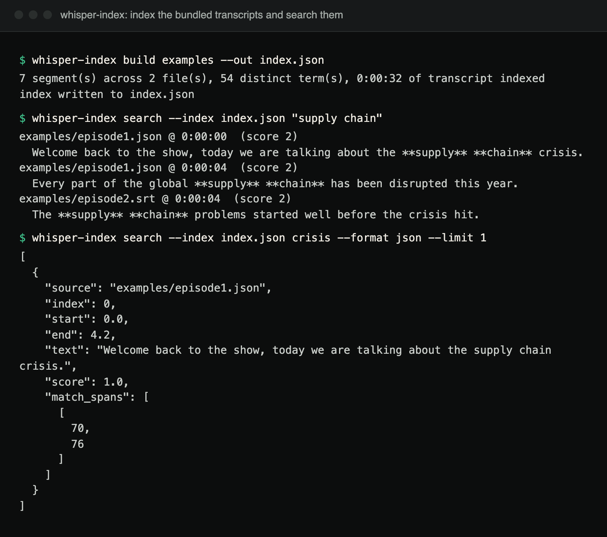

# whisper-index

Build a searchable, timestamped index over a library of Whisper
transcripts, so a query returns not just a matching line but the exact
moment to seek to. Zero runtime dependencies: Python 3.10+ and nothing
else.

```console
$ whisper-index build examples --out index.json
7 segment(s) across 2 file(s), 54 distinct term(s), 0:00:32 of transcript indexed
index written to index.json
$ whisper-index search --index index.json "supply chain"
examples/episode1.json @ 0:00:00  (score 2)
  Welcome back to the show, today we are talking about the **supply** **chain** crisis.
examples/episode1.json @ 0:00:04  (score 2)
  Every part of the global **supply** **chain** has been disrupted this year.
examples/episode2.srt @ 0:00:04  (score 2)
  The **supply** **chain** problems started well before the crisis hit.
```

(Real output for the committed `examples/`.)



*Terminal capture of the same session, plus `--format json`, run from a clone after `pip install .`.*

## What it indexes, and what it does not do

**This tool never runs speech recognition.** It indexes transcripts that
already exist: Whisper's own native JSON output (a `segments` array of
`{start, end, text}`), or the SRT/VTT files any Whisper wrapper can export.
That is what makes it a from-scratch, deterministic, dependency-free tool
rather than one that needs a model and a GPU: it does the part after
transcription, which most Whisper workflows leave you to solve yourself.

## Search semantics

Search is **AND-of-terms, whole-word, case-insensitive**: a result must
contain every query word somewhere in its segment. This is deliberate:
the point of "jump back to the source" is that each result is worth
listening to, and an OR search over a transcript index floods a two-word
query with segments matching only one word. Results are ranked by term
frequency within the segment and rendered with `**matches**` marked
in-place so you can see *why* a segment matched before you seek to it.

## Usage

```console
whisper-index build transcript.json other/ --out index.json   # files and dirs mix freely
whisper-index search --index index.json "some query"
whisper-index search --index index.json "some query" --format json --limit 5
```

Exit codes: `0` on success (including "no matches", which is a valid
answer, not a failure), `1` on an input error (unreadable file, bad
`--limit`, nothing to index), and `2` when argparse rejects the command
line (for example a missing `--index`).

The index is plain JSON, never pickle, so loading a shared index cannot run
code. Indexes record the source paths as given to `build`.

Words are Unicode letter/digit runs, lower-cased, so transcripts in any
language with spaces between words are indexed whole (`año`, `café`,
`straße`). Languages written without spaces (Chinese, Japanese, Thai) are not
segmented: a segment's text becomes one long token, so word search inside it
does not work. An index built by a version before the Unicode tokenizer is
refused ("format version 1") and must be rebuilt.

## Input formats

- **Whisper JSON**: `{"segments": [{"start": 0.0, "end": 2.5, "text": "..."}]}`,
  the shape `whisper.transcribe()` and the `whisper` CLI's `--output_format
  json` produce.
- **SRT**: numbered cues, `HH:MM:SS,mmm --> HH:MM:SS,mmm`.
- **WebVTT**: `WEBVTT` header, `HH:MM:SS.mmm --> HH:MM:SS.mmm`; inline
  `<b>`/`<i>`/`<c.color>` styling tags are stripped before indexing.

## Install

Not published on PyPI; install from a clone:

```console
git clone https://github.com/hellpuffyt/whisper-index && cd whisper-index
python -m venv .venv && . .venv/bin/activate   # .venv\Scripts\activate on Windows
pip install .
```

This puts `whisper-index` on the venv's `PATH`; `python -m whisper_index`
works too.

## Verification status

Parsing is tested against the exact layouts openai-whisper's writers emit
(JSON with `id`/`seek`/`tokens`/... fields, SRT, VTT with `MM:SS.mmm` below one
hour, `<u>` word-highlight tags), written by hand from the format definitions.
No speech model was run and no real Whisper output was captured for this
audit, so transcripts from other wrappers may need checking.

## Development

```console
pip install -e ".[dev]"
pytest                                # 78 tests
ruff check .
mypy                                  # strict, over src/
pytest -q --cov --cov-fail-under=95   # the coverage floor CI enforces
```

CI runs the tests on Python 3.10 to 3.13 on Ubuntu, Windows and macOS, ruff,
mypy and the coverage floor, and an end-to-end job that builds an index from
`examples/` and asserts the exact `supply chain` results shown above. See
[CONTRIBUTING.md](CONTRIBUTING.md) for the ground rules.

Security: [SECURITY.md](SECURITY.md). Audit evidence:
[docs/PRODUCTION_READINESS.md](docs/PRODUCTION_READINESS.md).

## License

MIT. See [LICENSE](LICENSE).
